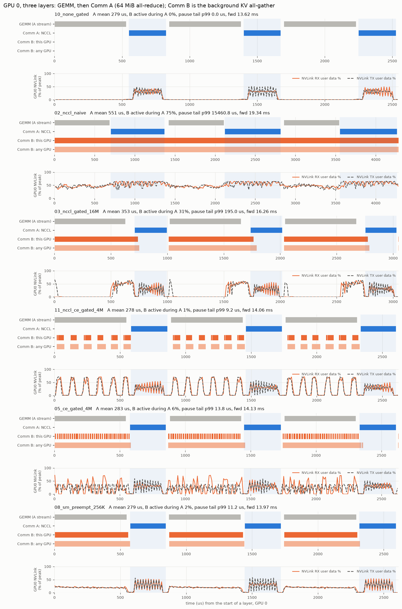
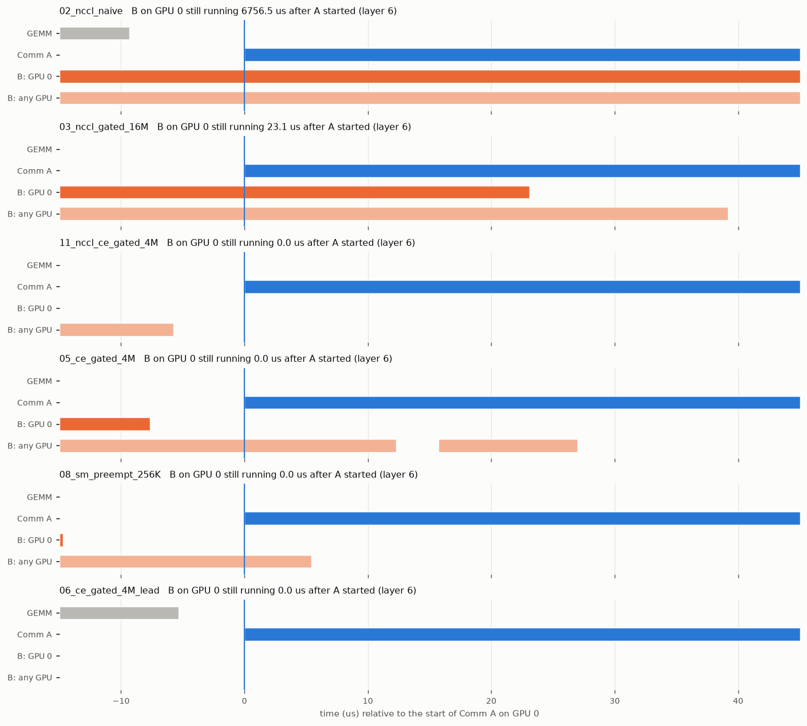
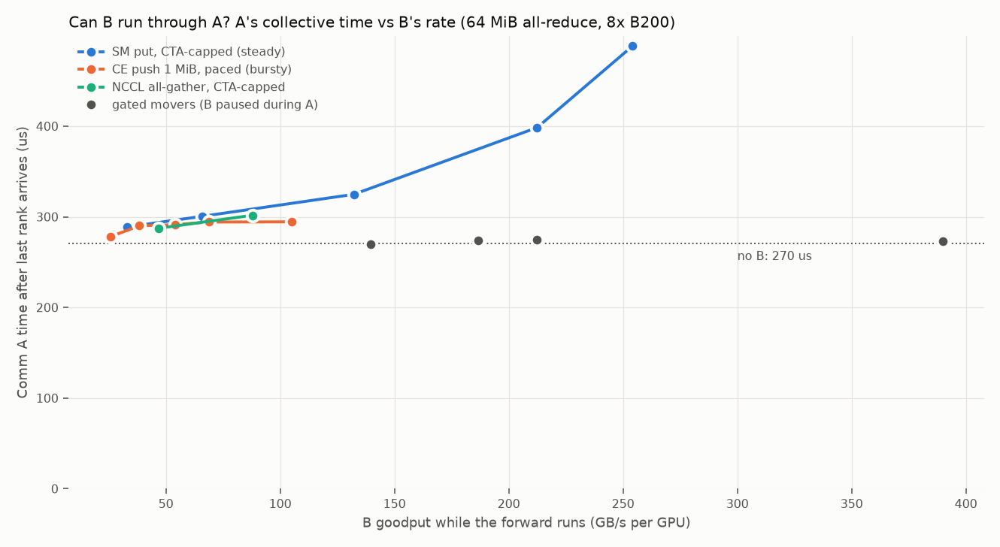

# Priority between GPU collectives: making a background KV all-gather yield to TP collectives

Status: proposal + measured prototype (8x B200, NVLink5/NVSwitch, driver 615.71, CUDA 13.0, NCCL 2.30.7;
2026-10-15).
Harness, raw results and nsys reports: `.sglang/comm-priority-20261015/`.

## 1. Problem

Two kinds of collective traffic share the same GPUs, SMs, HBM and NVLink:

| | Comm A | Comm B |
|---|---|---|
| What | TP/EP all-reduce, all-gather, reduce-scatter | all-gather that collects KV-cache pages from peers |
| Priority | critical path of the forward | best effort |
| Size | 1-128 MB per call, 2 per layer | tens of MB to GBs |
| Issued | NCCL on the main stream, often inside a CUDA graph | background stream / thread |

Requirement: when A arrives, B stops as fast as possible (bounded, microseconds), A gets the SMs,
copy engines and NVLink, and B resumes afterwards with no data loss and no host round trip.

## 2. What CUDA, the driver and NCCL give you (and do not)

Web research (6 domains, 13 agents; the 6 design-critical claims per domain were adversarially re-checked
against primary sources). The full catalog with links, including the register of unverified items (its
Section 4.0), is in `.sglang/comm-priority-20261015/research_synthesis.md`. Probes on this machine are
in `out/probe.txt`.

**Nothing can preempt, pause or cancel an in-flight kernel, copy or collective on demand.**

| Mechanism | Stops in-flight B? | Why not / what it is good for |
|---|---|---|
| Stream priority, `cudaLaunchAttributePriority`, graph node priority | No | "provide a hint ... but do not preempt already-running work" (Runtime API, since 12.3). Only reorders *pending* CTAs of *kernels*; copies are not affected. Needed anyway (A highest, B lowest). |
| Compute preemption (`computePreemptionSupported=1` here) | No | Context switch between *contexts* at timeslice granularity (~ms); not exposed within a context. |
| Cluster Launch Control (sm_100) | Partly | `try_cancel` fails when a higher-priority kernel is pending, so a *cooperating* persistent kernel can step aside; no latency bound. |
| Green contexts / MPS partitions / NCCL `maxCTAs` | No | Static SM partition. No HBM/NVLink isolation. Measured here: B in a 16-SM green context got almost no time during primary-context GEMMs (6 GB/s), so it is not a reservation in this setup (Section 5.3). |
| Copy engines | No | No cancel, no priority ("only compute kernels ... are affected"). Driver source (open-gpu-kernel-modules 615.78.08, `kernel_ce_gb100.c`) assigns one logical CE to P2P on NVSwitch; that all peer copies use it is inferred. |
| NVLink / NVSwitch / HBM QoS | No | Does not exist (NCCL `trafficClass` is IB/RoCE only). |
| `ncclCommRevoke` / `ncclCommAbort` / `ncclCommShrink(ABORT)` | Yes, terminal | Comm is dead afterwards; re-init was ~0.7 s on 8xH100 per the NCCL 2.22 blog (not measured here). `ncclCommSuspend` requires no outstanding ops. NCCL (through 2.32) has no priority between communicators. |
| `cudaLaunchHostFunc`, events, external semaphores | No | Host functions may not wait on GPU work; events bind at enqueue time. Too coarse anyway. |

**What does exist and is enough to build cooperative preemption:**

| Primitive | Measured / verified here |
|---|---|
| `cuStreamWriteValue32/64`, `cuStreamWaitValue32/64`, `cuStreamBatchMemOp` (driver API, v2) | Zero SMs (GPU front end), but ~14-15 us per gate edge on the issuing stream when it writes 8 peers (Section 6). Wait-NOR and 64-bit ops supported on B200. **A write to a peer GPU's memory through a P2P mapping works, and so does a wait on a peer address** (`out/probe.txt`; the benchmark itself exercises peer writes and local waits). Captured into a CUDA graph as batch-mem-op nodes (Section 5.5). |
| Peer copies on copy engines (`cudaMemcpyAsync`, `cudaMemcpyBatchAsync`) | Zero SMs. All-to-all push with raw P2P pointers, B alone: 310-317 GB/s/GPU at 4 MiB chunks (1, 4 or 7 streams), 421 at 16 MiB (`out/extra.jsonl`). |
| NCCL 2.30 zero-SM all-gather (`CTAPolicy=NCCL_CTA_POLICY_ZERO` + symmetric window) | Zero SMs. 709 GB/s/GPU alone (64 MiB calls). Alongside the forward: 266 (4 MiB gated), 415 (16 MiB gated), 564 (64 MiB ungated). |
| A custom SM copy kernel that polls a word in device memory | Exits within one work item of the word flipping. |

So "stop B" has to be **cooperative**: B is split into idempotent chunks, a GPU-resident gate is
checked before each chunk, and A closes/opens the gate from its own stream with zero-SM memory ops.

## 3. Design: a GPU-side communication arbiter

### 3.1 Control plane: the arbiter page

One page per GPU, in plain unicast device memory (`cudaMalloc`/`cuMemCreate`, shared with peers through
P2P or POSIX-FD IPC). Never multicast, EGM or fabric memory: stream memops are rejected there.

```
struct ArbiterPage {               // lives on GPU g, mapped into every peer of the B group
  uint32 busy[NCLASS][NRANKS];     // busy[c][r] != 0  <=>  rank r is inside a class-c (higher-priority) op
  uint32 done_epoch[NRANKS];       // push movers: sender r writes its transfer epoch here when its last
                                   // copy into this GPU has completed (Section 3.3)
  uint64 progress[NSTREAM];        // B progress in bytes, written by B's own streams (observability)
};
```

Priority classes are ordered: class 0 (TP/EP collectives) > class 1 (KV gather) > class 2 (e.g. weight
prefetch, checkpoint traffic). A class-c consumer yields to every class `< c`.

**Producer side (A).** Around every high-priority collective, on A's own stream:

```
arb.enter(stream, cls=0)   // one cuStreamBatchMemOp: WRITE busy[0][my_rank] = 1 on every page in scope
ncclAllReduce(..., stream) // unchanged
arb.exit(stream, cls=0)    // WRITE busy[0][my_rank] = 0
```

- **Zero SMs, but not free on A's stream.** Measured (Section 6, item 5): with NVLink idle, a batch of 8
  fenced P2P writes adds ~14 us before A and ~15 us after it (+3.5% per layer). The close grows by up to
  another ~30 us while B is busy on NVLink. One local write (local scope) adds about half as much. Every
  v2 memop write is fenced; there is no cheaper variant.
- Capturable: the whole forward, gate writes included, captures into one CUDA graph (Section 5.5).
- Absolute values (1/0) make graph replay idempotent. One slot per source rank avoids atomics. A single
  reference-counted word per class (`CU_STREAM_MEM_OP_ATOMIC_REDUCTION` ADD +1/-1, CUDA >= 13.1) would
  support several producers per rank, e.g. TP all-reduce and EP all-to-all on different streams. That is
  untested, and graph capture of that memop is undocumented.
- **Scope**, defined relative to A's group:
  - `local`: write only this GPU's page.
  - `global`: also write the pages of the B-group ranks that are in the same A group, so a rank in A
    silences peers that are still pushing into it. Both A and B span the same 8 GPUs in the prototype.
  - A B group that spans several unsynchronized A groups (DP replicas, PD) would pause during the union
    of their A intervals. That case is not measured.
- **Lookahead close.** `enter` may sit one op earlier, before the last compute op preceding A. B's
  in-flight chunk then drains under compute and A starts on a quiet link. The close still executes on
  A's stream (between the two ops), and B loses that op's window.

**Consumer side (B).** B never sees A; it only sees the page:

```
for chunk in plan:                        // on B's lowest-priority stream(s)
    arb.gate(stream, cls=1)               // one cuStreamBatchMemOp: N waits, busy[0][r] == 0, in slot order
    mover.copy(chunk, stream)             // NCCL CE call / CE copy / SM kernel
    cuStreamWriteValue64(progress, bytes) // optional
```

The gate is N per-slot waits evaluated in order, not one atomic test. A slot that closes again after its
wait passed is caught at the next gate, which is within the one-chunk bound below.

When the gate is closed the B stream parks in the front end: no SMs used, no copies issued. When it
opens, the next chunk starts with no host involvement. **Pause latency is bounded by what is already
past the gate**: one chunk per B stream, plus one more if the close races the wait.

### 3.2 Data plane: three movers, one gate

| Mover | How B moves bytes | Pause granularity | SMs | Notes |
|---|---|---|---|---|
| **M1: NCCL zero-SM all-gather** (`CTAPolicy=ZERO`, symmetric window) | copy engines, NCCL-managed | one call (4-16 MiB/rank) | 0 | Highest gated bandwidth at 16 MiB chunks (384 GB/s during the forward). Two-sided: every rank issues the same chunk sequence. Its deadlock-freedom depends on NCCL ordering (3.3). |
| **M2: gated CE push** (`cudaMemcpy[Batch]Async` to peer pointers) | copy engines, one-sided | one chunk per CE stream | 0 | Rank-local pause, no cross-rank protocol. Same bandwidth as M1 at 4 MiB chunks (202 vs 212 GB/s), ~70% at 16 MiB (263 vs 384). Lowest A p99 of the gated movers. Natural fit for scattered pages issued from a host page table. |
| **M3: yielding SM kernel** (`kv_put_kernel`) | SM stores to peer pointers | one work item (64 KB-1 MB) | N CTAs while running, 0 while paused | Polls the page before each item and exits. The stream holds `[gate][kernel][gate][kernel]...`; each relaunch resumes from a device cursor. Same pause tail as the CE movers (p99 ~11 us), but next to the GEMMs it moves only 122-176 GB/s at any stream priority. Whether that is SM residency or HBM contention is not isolated. |

Rejected as B movers:
- Plain NCCL SM collectives. With default CTAs they slow A 2x. Capped at 4 CTAs they leave A unchanged
  but move only 88 GB/s. Gated, they hold SMs spinning on peers and B's goodput collapses (Section 6).
- `ncclCommRevoke`: terminal.

### 3.3 Multi-rank consistency and completion

- **One-sided movers (M2, M3).** A pause is rank-local: nothing waits on a peer, so a paused rank can
  never strand a peer inside a collective.
- **Completion for push movers.** A local event on the sender only says that *its own* pushes are done,
  while a receiver needs all N-1 peers' pushes into its buffer. So:
  - after its last copy into receiver g, sender r writes `done_epoch[r] = epoch` into g's page (remote
    memop, ordered after the copy on the same stream);
  - the receiver's KV consumer waits on the N-1 slots with `cuStreamWaitValue32 ... GEQ epoch`.

  The prototype checks completion with a host barrier instead; this flag protocol is not yet exercised.
- **Two-sided mover (M1).** Per chunk, all ranks rendezvous. A rank whose gate is closed delays its peers'
  chunk k, and those peers park on NCCL's CE barrier (zero SMs). With a gate on every rank this pauses B
  globally by construction, so local scope is enough for M1. A local event after the call is a valid
  completion signal, because the collective completes on every rank. **Deadlock-freedom is conditional:**
  - NCCL must never order A behind one of B's in-flight NCCL ops. Same or split-shared communicators do
    this, and so may `NCCL_LAUNCH_ORDER_IMPLICIT=1`.
  - The research flags `NCCL_GRAPH_STREAM_ORDERING=1` (default since 2.30) as possibly ordering a
    *captured* A behind B "across graphs and communicators that share a GPU". If so, q's A waits for
    q's B chunk, which waits for r's B chunk, which waits for r's gate, which waits for r's A, which
    waits for q's A: a cycle.
  - The prototype saw no deadlock: each mover ran once in graph mode, 6 iterations of 32 layers, with
    no skew injection. That is not a proof.
- **Source and destination leases.** The sender keeps its source pages until its own copies finish. The
  receiver keeps destination pages reserved until every peer's completion flag has arrived.

### 3.4 Resume

Automatic: the parked gate wait releases when every `busy` word is 0, and chunks not yet issued are
untouched. M3 relaunches from the device-side cursor (`Work::next`), so no item is lost or duplicated
(validated: every received byte is checked in every run). In the design the host keeps a bounded window
of chunks enqueued and is never on the pause/resume path. The prototype bounds the window only for M3;
M1 and M2 enqueue the whole plan up front.

### 3.5 Requirements

Reproduced in this prototype (each one hung it):

1. **Enough hardware work queues.** With the default `CUDA_DEVICE_MAX_CONNECTIONS=8`, a B stream parked
   on a stream-wait aliased with other streams' queues: CE pulls from 7 peers hung on 8 GPUs (5-7 GPUs,
   and push, did not). 32 fixed it in this harness, which has about 6 streams per GPU.
   - 32 is the maximum, so aliasing (and the hang) is still possible with more streams per device.
   - Bound the stream count, also set `CUDA_DEVICE_MAX_COPY_CONNECTIONS=32`, or isolate B's work queues
     (CUDA 13.1 workqueue configuration).
2. **No lazy module loading while a gate can be closed.** Every kernel that may first launch while any
   stream is parked on a memop must be loaded first. This covers NCCL's first-call connection setup,
   cuBLAS (including *each new GEMM shape*: the half-width GEMMs of lookahead hung until warmed up), and
   the B kernel itself. Warm up, or use `CUDA_MODULE_LOADING=EAGER` plus warm-up.

From NCCL, driver and NVSHMEM sources (research), not exercised here:

3. **A and B on different NCCL communicators, no `splitShare`.** Same-communicator ops are serialized
   by NCCL. That turns "B waits for A" into "A waits for B", a cycle. See 3.3 for the ordering knobs.
4. **Keep A off the copy engines.** Driver source (615.78.08) assigns one logical CE to P2P traffic on
   NVSwitch. An A that NCCL moved to CE (large symmetric-window all-gathers on Blackwell, NCCL >= 2.29.2)
   could share it with B's chunks. That every peer copy uses that CE is inferred, and one logical CE is
   time-sliced across channels rather than one FIFO. Keep A's buffers out of symmetric windows, or raise
   `NCCL_SYM_CE_THRESHOLD`.
5. **Gate words in unicast device memory.** Memops fail on multicast, EGM and fabric addresses. Peer
   memop writes were exercised only within one process (`cudaDeviceEnablePeerAccess`); cross-process
   `cuMemImport` mappings are untested.

## 4. Proposed API

```cpp
enum class Scope { kLocal, kGlobal };   // kGlobal: every B-group rank that shares this rank's A group

class CommArbiter {
 public:
  // pages[g]: the arbiter page on GPU g, plain unicast memory mapped into this process (P2P / IPC)
  CommArbiter(int rank, int nranks, std::vector<ArbiterPage*> pages, Scope scope);
  void enter(cudaStream_t s, int cls);   // cuStreamBatchMemOp WRITE busy[cls][rank]=1 on pages in scope
  void exit(cudaStream_t s, int cls);    // ... = 0
  void gate(cudaStream_t s, int cls);    // cuStreamBatchMemOp WAIT busy[c][*]==0 for every c < cls
  const uint32_t* device_view(int cls);  // for SM movers: poll before each work item
};

// B side
class BackgroundGather {
  BackgroundGather(CommArbiter&, Mover kind /* CePush | NcclZeroSm | SmYield */, size_t chunk_bytes);
  // Returns the epoch; a consumer on receiver g waits until done_epoch[r] >= epoch for every sender r
  // (push movers), or on the returned event (NcclZeroSm).
  uint32_t submit(const PagePlan& plan, cudaEvent_t* nccl_done = nullptr);
};
```

Python integration (sketch):
- Wrap the TP group's `all_reduce/all_gather/reduce_scatter` in `arbiter.enter/exit`, captured once into
  the prefill graphs.
- For decode-sized collectives, measure the gate cost first: ~14-15 us per edge may exceed a 1 MiB
  all-reduce.
- Route the KV gather through `BackgroundGather`.
- Call the memops through `cuda.bindings.driver` and resolve the `_v2` symbols: ctypes lookups of the
  bare names return the deprecated v1 entry points.

## 5. Benchmark

### 5.1 Harness

`src/prio_bench.cu` (one binary, CUDA 13.0, NCCL 2.30.7, run in `zsk-sglang`): one process, 8 GPUs, an
A-thread and a B-thread per GPU, separate NCCL communicators for A and B.

- **Model forward (A side, highest-priority stream):** `L` layers of `[bf16 GEMM 8192x7168x7168 (~0.55 ms)]
  -> [A collective]`. A = all-reduce 64 MiB by default; also 8 MiB, and an AR/AG/RS rotation.
  Gate writes (`enter`/`exit`) sit right before/after A, or with `--lead 1` one op earlier (the GEMM is
  split in two and the gate closes between the halves).
- **KV gather (B side, lowest-priority stream):** an all-gather of a 2 GiB shard per rank (14 GiB
  ingress per GPU, outlasting the forward) through one of the movers:

  | `--b` | What it is |
  |---|---|
  | `nccl` | one `ncclAllGather` of the whole shard (today's naive approach) |
  | `nccl-gated` | `ncclAllGather` per chunk, gate before each chunk |
  | `nccl-ce[-gated]` | NCCL 2.30 zero-SM all-gather (`CTAPolicy=ZERO`, symmetric window), per chunk |
  | `ce[-gated]` | copy-engine push to peer pointers (`cudaMemcpyBatchAsync`, 4 streams), per chunk |
  | `sm` / `sm-preempt` | SM put kernel (16 CTAs); `-preempt` polls the arbiter page per item and exits, resumed by a `[gate][kernel]` chain |
  | `none` / `none-gated` | no B; `none-gated` keeps the gate writes on A's stream (control) |

- All 8 GPUs are released by **one** batched memop write from GPU 0, so host-thread wake-up skew never
  reaches the GPUs. Iteration 0 is warm-up; reported numbers are over the rest. Every run validates
  every received byte of B (`bad` = 0 in every row).
- Each run waits until no other process holds a GPU and is discarded and retried if one appears
  (another session shared this node).

**Metrics.**
- `fwd`: forward wall time, max over ranks.
- `GEMM + gate close`: cudaEvents from the start of the GEMM to just before A (`evG0 -> evA0`); in gated
  modes it includes the gate close. Kernel-only GEMM times come from nsys (Section 5.4).
- `A`: per-rank A time from cudaEvents around the collective, mean over ranks. It includes the wait for
  the last rank to arrive; the nsys analysis splits it into *arrival skew* and *time after the last arrival*.
- `B goodput during fwd`: bytes B had moved when the forward ended / the part of the forward B was alive,
  slowest rank. `B total`: time for the whole B transfer, slowest rank.
- From nsys (`analyze_nsys.py`): *B busy during A* (fraction of each A interval in which a B op is running
  on this GPU / on any GPU), *B tail into A* (how long B ops that were already running when A started keep
  running - the pause latency A actually sees), *B ops starting inside A* (gate leaks), *resume* (A end ->
  next B op start), and GPU-0 NVLink RX/TX user-data throughput and GPC clock from the `gb10x` metric set.

**Reproduce:**
```bash
cd .sglang/comm-priority-20261015 && ./run.sh ./build.sh && ./run.sh ./final.sh
```
`final.sh` = `repeat.sh` (headline, 3 interleaved reps) + `sweep.sh` (matrix) + `profile.sh` (nsys);
`./run.sh "python3 analyze_nsys.py && python3 make_tables.py"` renders the tables and `out/timeline_*.png`.

### 5.2 Headline (untraced; 32 layers, A = 64 MiB all-reduce, 3 interleaved repetitions, median)

Host umbriel-b200-048. The 5 key rows were re-run once on umbriel-b200-074 (`out/crosshost.jsonl`):
forward within 0.5%, A mean within 1.1%, B goodput within 2.2%. Graph rows capture the whole 32-layer
forward (gate writes included) as one CUDA graph; per-layer A is not timed in graph mode.

| B mode | B SMs | fwd ms (vs none-gated) | A mean / p99 us | GEMM + gate close us | B goodput during fwd GB/s | B total ms (GB/s) | reps |
|---|---|---|---|---|---|---|---|
| none | - | 28.44 (+1.6%) | 334 / 410 | 552 | n/a | - | 3 |
| none-gated | - | 28.00 | 300 / 326 | 555 | n/a | - | 3 |
| nccl | NCCL CTAs | 38.88 (+38.8%) | 562 / 796 | 645 | n/a | 31.5 (477) | 3 |
| nccl-gated 16M | NCCL CTAs | 32.50 (+16.1%) | 349 / 398 | 648 | 116 | 53.5 (281) | 3 |
| nccl-ce-gated 4M | 0 | 28.12 (+0.4%) | 288 / 307 | 572 | 212 | 56.6 (266) | 3 |
| ce-gated 4M | 0 | 28.33 (+1.2%) | 286 / 292 | 580 | 202 | 57.9 (260) | 3 |
| ce-gated 4M lookahead | 0 | 27.43 (-2.1%) | 288 / 296 | 550 | 102 | 66.6 (226) | 3 |
| sm-preempt 256K x16 | 16 CTAs (0 paused) | 27.96 (-0.1%) | 286 / 292 | 570 | 143 | 47.2 (318) | 3 |
| none graph | - | 28.75 (+2.7%) | n/a / n/a | n/a | n/a | - | 1 |
| nccl graph | NCCL CTAs | 38.52 (+37.6%) | n/a / n/a | n/a | n/a | 30.2 (498) | 1 |
| ce-gated 4M graph | 0 | 27.92 (-0.3%) | n/a / n/a | n/a | 204 | 57.5 (262) | 1 |
| nccl-ce-gated 4M graph | 0 | 27.75 (-0.9%) | n/a / n/a | n/a | 213 | 56.5 (266) | 1 |
| sm-preempt 256K x16 graph | 16 CTAs (0 paused) | 27.68 (-1.1%) | n/a / n/a | n/a | 143 | 46.9 (320) | 1 |
| nccl-gated 16M graph | NCCL CTAs | 32.08 (+14.6%) | n/a / n/a | n/a | 117 | 53.2 (282) | 1 |

**Read the deltas with care.** The untraced control `none-gated` shows a per-rank A of 290-304 us, above
every gated row with B running (285-288 us). Plain `none` is higher still (317-364 us at >= 32 layers;
Section 8, item 1). Untraced forward deltas within about 2% are therefore not resolvable here. The nsys
critical path (Section 5.4) gives the conservative cost of the zero-SM movers: +3.3% (`nccl-ce-gated 4M`)
and +3.8% (`ce-gated 4M`) over `none-gated`, and +6.9% / +7.4% over no gate and no B.

### 5.3 Full matrix (untraced, single runs, host -048) and controls (host -074)

| B mode | A | fwd ms | A mean / p99 us | GEMM + gate close us | B goodput during fwd GB/s | B total GB/s | SM pause exits / launches |
|---|---|---|---|---|---|---|---|
| none | ar 64M | 27.78 | 317 / 398 | 548 | n/a | - | - |
| none lookahead | ar 64M | 30.40 | 392 / 503 | 554 | n/a | - | - |
| none-gated | ar 64M | 27.73 | 293 / 305 | 556 | n/a | - | - |
| none-gated local | ar 64M | 28.41 | 321 / 356 | 559 | n/a | - | - |
| nccl | ar 64M | 38.42 | 553 / 799 | 640 | n/a | 490 | - |
| nccl equal-prio | ar 64M | 38.89 | 564 / 784 | 644 | n/a | 484 | - |
| nccl maxCTAs=4 | ar 64M | 27.59 | 318 / 324 | 540 | n/a | 88 | - |
| nccl-gated 4M | ar 64M | 30.18 | 302 / 340 | 622 | 31 | 167 | - |
| nccl-gated 16M | ar 64M | 32.48 | 350 / 392 | 647 | 116 | 281 | - |
| nccl-gated 64M | ar 64M | 44.25 | 767 / 812 | 583 | 329 | 339 | - |
| nccl-gated 16M local | ar 64M | 30.33 | 390 / 404 | 550 | 124 | 293 | - |
| nccl-ce 64M | ar 64M | 33.82 | 474 / 886 | 574 | 565 | 564 | - |
| nccl-ce-gated 4M | ar 64M | 28.16 | 288 / 310 | 573 | 214 | 267 | - |
| nccl-ce-gated 16M | ar 64M | 29.32 | 285 / 291 | 612 | 384 | 415 | - |
| ce 4M | ar 64M | 32.93 | 465 / 518 | 556 | 232 | 268 | - |
| ce-gated 1M | ar 64M | 27.59 | 283 / 288 | 561 | 96 | 140 | - |
| ce-gated 4M | ar 64M | 28.29 | 285 / 290 | 580 | 203 | 261 | - |
| ce-gated 16M | ar 64M | 29.59 | 296 / 318 | 609 | 263 | 318 | - |
| ce-gated 4M local | ar 64M | 27.32 | 288 / 300 | 558 | 208 | 264 | - |
| ce-gated 4M lookahead | ar 64M | 27.43 | 288 / 296 | 550 | 102 | 225 | - |
| sm 256K x16 | ar 64M | 34.01 | 500 / 572 | 558 | 254 | 269 | - |
| sm-preempt 64K x16 | ar 64M | 27.71 | 284 / 288 | 564 | 122 | 247 | 512 / 33 |
| sm-preempt 256K x16 | ar 64M | 27.98 | 286 / 292 | 570 | 143 | 316 | 512 / 33 |
| sm-preempt 1024K x16 | ar 64M | 28.16 | 291 / 297 | 571 | 151 | 342 | 512 / 33 |
| sm-preempt 256K x16 local | ar 64M | 27.34 | 293 / 322 | 554 | 144 | 318 | 512 / 33 |
| sm-preempt 256K x32 | ar 64M | 28.32 | 287 / 294 | 580 | 176 | 353 | 1024 / 33 |
| sm-preempt 256K x16 equal-prio | ar 64M | 27.92 | 285 / 294 | 569 | 143 | 319 | 512 / 33 |
| sm-preempt 256K x16 green16 | ar 64M | 27.54 | 283 / 287 | 559 | 6 | 286 | 512 / 33 |
| none | ar,ag,rs 64M | 25.03 | 226 / 381 | 553 | n/a | - | - |
| nccl | ar,ag,rs 64M | 34.28 | 390 / 793 | 673 | n/a | 467 | - |
| nccl-gated 16M | ar,ag,rs 64M | 29.74 | 266 / 400 | 645 | 126 | 295 | - |
| ce-gated 4M | ar,ag,rs 64M | 26.33 | 221 / 394 | 582 | 209 | 259 | - |
| sm-preempt 256K x16 | ar,ag,rs 64M | 25.86 | 219 / 360 | 571 | 147 | 318 | 512 / 33 |
| none | ar 8M | 21.38 | 116 / 135 | 549 | n/a | - | - |
| nccl | ar 8M | 28.39 | 184 / 254 | 695 | n/a | 470 | - |
| nccl-gated 16M | ar 8M | 26.58 | 167 / 246 | 645 | 140 | 304 | - |
| ce-gated 4M | ar 8M | 22.13 | 94 / 103 | 578 | 257 | 288 | - |
| ce-gated 1M | ar 8M | 21.27 | 90 / 93 | 556 | 124 | 138 | - |
| sm-preempt 256K x16 | ar 8M | 21.76 | 94 / 100 | 567 | 181 | 360 | 512 / 33 |

Controls and variants added after review (host -074):

| B mode | A | fwd ms | A mean / p99 us | GEMM + gate close us | B goodput during fwd GB/s | B total GB/s | SM pause exits / launches |
|---|---|---|---|---|---|---|---|
| none-gated lookahead | ar 64M | 28.17 | 318 / 365 | 544 | n/a | - | - |
| nccl-ce-gated 4M local | ar 64M | 27.53 | 295 / 317 | 558 | 216 | 268 | - |
| nccl-ce-gated 16M local | ar 64M | 28.71 | 304 / 320 | 585 | 393 | 418 | - |
| ce-gated 4M local | ar 64M | 27.48 | 291 / 313 | 560 | 208 | 264 | - |
| none-gated | ar 8M | 21.89 | 102 / 112 | 563 | n/a | - | - |
| none-gated | ar,ag,rs 64M | 26.36 | 234 / 382 | 571 | n/a | - | - |

B alone (no forward), 2 GiB shards, host -074:

| B alone (2 GiB shard per rank) | ingress GB/s per GPU | B time ms |
|---|---|---|
| NCCL all-gather (SM kernels), one call | 668 | 22.5 |
| NCCL zero-SM CE all-gather, 64 MiB calls | 709 | 21.2 |
| CE push, 4 MiB chunks, 1 stream(s) | 310 | 48.5 |
| CE push, 4 MiB chunks, 4 stream(s) | 317 | 47.4 |
| CE push, 4 MiB chunks, 7 stream(s) | 310 | 48.4 |
| CE push, 16 MiB chunks, 4 stream(s) | 421 | 35.7 |
| SM put kernel, 16 CTAs | 611 | 24.6 |
| SM put kernel, 32 CTAs | 702 | 21.4 |

### 5.4 nsys timelines

Setup: 16 layers, 1 GiB B shard per rank, one measured iteration (`--capture-range=cudaProfilerApi`),
GPU-0 metrics (`gb10x`) at 100 kHz, host -074. `13_none_L32` is 32 layers, from `baseline_check.sh`.
Reports: `out/nsys/*.nsys-rep`. Streams are named `A-main gpuN` / `B-kv[k] gpuN`, and NVTX ranges
`L<i> GEMM` / `L<i> A:ar`.

**What A sees.** "A per rank" includes waiting for the last rank. "A after last arrival" is the
collective itself.

| trace | A per rank us | arrival skew us | A after last arrival us (p99) | B busy during A (this GPU / any GPU) | B tail into A us mean / p99 / max | B ops starting inside A | resume us (median) | GPU0 NVLink RX/TX % during A | GPU0 GPC MHz GEMM / A |
|---|---|---|---|---|---|---|---|---|---|
| 01_none | 279 | 15 | 270 (276) | 0.0% / 0.0% | 0.0 / 0.0 / 0.0 | 0 | n/a | 25 / 25 | 1522 / 1906 |
| 02_nccl_naive | 551 | 37 | 527 (695) | 73.5% / 75.0% | 5657.8 / 15460.8 / 15486.8 | 0 | n/a | 51 / 50 | 1552 / 1938 |
| 03_nccl_gated_16M | 353 | 151 | 276 (279) | 25.8% / 30.5% | 102.1 / 195.0 / 208.5 | 0 | 25.3 | 25 / 25 | 1676 / 1965 |
| 04_nccl_ce_gated_16M | 277 | 8 | 273 (280) | 0.6% / 1.6% | 1.7 / 13.2 / 13.8 | 0 | 40.0 | 25 / 25 | 1460 / 1924 |
| 05_ce_gated_4M | 283 | 16 | 274 (279) | 1.6% / 6.2% | 2.2 / 13.8 / 14.8 | 24 | 20.3 | 25 / 25 | 1494 / 1928 |
| 06_ce_gated_4M_lead | 283 | 16 | 275 (279) | 0.0% / 0.0% | 0.0 / 0.0 / 0.0 | 0 | 20.8 | 24 / 24 | 1463 / 1874 |
| 07_sm_naive | 497 | 18 | 488 (525) | 90.2% / 100.0% | 11168.6 / 27288.1 / 27438.4 | 0 | n/a | 48 / 55 | 1480 / 1935 |
| 08_sm_preempt_256K | 279 | 15 | 270 (272) | 0.5% / 2.1% | 1.4 / 11.2 / 13.5 | 0 | 24.6 | 25 / 25 | 1504 / 1929 |
| 09_ce_naive_4M | 408 | 18 | 397 (432) | 59.1% / 99.7% | 3.1 / 17.5 / 18.2 | 1145 | 3.2 | 25 / 25 | 1491 / 1924 |
| 10_none_gated | 279 | 14 | 271 (277) | 0.0% / 0.0% | 0.0 / 0.0 / 0.0 | 0 | n/a | 25 / 25 | 1525 / 1931 |
| 11_nccl_ce_gated_4M | 278 | 6 | 275 (278) | 0.2% / 1.0% | 0.5 / 9.2 / 22.7 | 0 | 40.6 | 25 / 25 | 1490 / 1924 |
| 12_sm_preempt_256K_local | 280 | 15 | 270 (273) | 3.3% / 7.6% | 9.3 / 16.6 / 17.0 | 0 | 14.1 | 25 / 25 | 1507 / 1919 |
| 13_none_L32 | 280 | 16 | 270 (274) | 0.0% / 0.0% | 0.0 / 0.0 / 0.0 | 0 | n/a | 25 / 25 | 1528 / 1910 |

**Per-layer critical path on A's stream** (mean over GPUs and layers). GEMM is kernel time only. The
gaps around A contain the gate close and open.

| trace | GEMM us | gap between GEMM halves | GEMM end -> A start | A (per rank) | A end -> next GEMM | layer total us |
|---|---|---|---|---|---|---|
| 01_none | 532 | 0.0 | 4.9 | 279 | 7.0 | 823 |
| 02_nccl_naive | 632 | 0.0 | 8.6 | 551 | 18.3 | 1209 |
| 03_nccl_gated_16M | 580 | 0.0 | 61.1 | 353 | 22.8 | 1017 |
| 04_nccl_ce_gated_16M | 560 | 0.0 | 48.6 | 277 | 23.0 | 909 |
| 05_ce_gated_4M | 545 | 0.0 | 32.6 | 283 | 24.5 | 884 |
| 06_ce_gated_4M_lead | 513 | 29.6 | 5.2 | 283 | 25.2 | 856 |
| 07_sm_naive | 555 | 0.0 | 7.0 | 497 | 11.5 | 1071 |
| 08_sm_preempt_256K | 545 | 0.0 | 27.6 | 279 | 22.4 | 874 |
| 09_ce_naive_4M | 546 | 0.0 | 8.3 | 408 | 13.1 | 975 |
| 10_none_gated | 532 | 0.0 | 18.6 | 279 | 22.2 | 852 |
| 11_nccl_ce_gated_4M | 546 | 0.0 | 32.5 | 278 | 23.2 | 880 |
| 12_sm_preempt_256K_local | 544 | 0.0 | 13.3 | 280 | 11.4 | 849 |
| 13_none_L32 | 532 | 0.0 | 4.9 | 280 | 7.2 | 824 |

Figures:
- `out/timeline_key_modes.png`: three layers of GPU 0 for 6 modes, with NVLink RX/TX.
- `out/pause_zoom.png`: microseconds around one A start.
- `out/timeline_<trace>.png`: one per trace.





### 5.5 CUDA graphs

The forward (GEMMs, gate writes as batch-mem-op nodes, NCCL kernels) captures into one graph and
replays without deadlock for every mover, including the two-sided ones (one run of 6 x 32 layers each).
Forward time is within 1.5% of eager and B goodput within 1% (single runs; Section 5.2 graph rows).

Not covered:
- per-layer A and B-during-A under graph replay (no graph-mode trace was taken);
- lookahead under capture;
- skew injection.

B itself stays eager: `cudaMemcpyBatchAsync` cannot be captured.

### 5.6 Rate-limited B running through A (no gate)

Question: if A does not need the full link, can B run continuously, at a lower rate, without hurting A?
Three ways of throttling an ungated B were tried:
- SM put kernel with 1-16 CTAs: a steady cap of roughly 35 GB/s per CTA, with no bursts;
- copy-engine push in 1 MiB rounds with a 0-200 us sleep between rounds: an average cap, each copy still
  at full speed;
- plain NCCL all-gather capped at 2 or 4 CTAs.

Setup: nsys, 16 layers, 64 MiB all-reduce, host -074, one trace each (128 A samples). Gated rows for
reference. Script: `profile_rate.sh`, `rate_analysis.py`.

| trace | B rate during fwd GB/s | A after last arrival us (p99) | vs no-B | A per rank us | skew us | GEMM kernel us | fwd ms (16 layers) | GPU0 NVLink TX % during A / GEMM |
|---|---|---|---|---|---|---|---|---|
| 01_none | 0 | 270 (276) | +0.0% | 279 | 15 | 532 | 13.17 | 25 / 0 |
| 04_nccl_ce_gated_16M | 390 | 273 (280) | +1.0% | 277 | 8 | 560 | 14.52 | 25 / 53 |
| 05_ce_gated_4M | 186 | 274 (279) | +1.4% | 283 | 16 | 545 | 14.13 | 25 / 24 |
| 07_sm_naive | 254 | 488 (525) | +80.6% | 497 | 18 | 555 | 17.13 | 55 / 37 |
| 08_sm_preempt_256K | 140 | 270 (272) | -0.3% | 279 | 15 | 545 | 13.97 | 25 / 20 |
| 11_nccl_ce_gated_4M | 212 | 275 (278) | +1.7% | 278 | 6 | 546 | 14.06 | 25 / 28 |
| 20_sm_cta1 | 33 | 289 (294) | +6.8% | 298 | 15 | 536 | 13.59 | 27 / 3 |
| 21_sm_cta2 | 66 | 301 (307) | +11.2% | 311 | 16 | 539 | 13.87 | 29 / 5 |
| 22_sm_cta4 | 132 | 325 (328) | +20.1% | 335 | 15 | 543 | 14.31 | 34 / 11 |
| 23_sm_cta8 | 212 | 398 (410) | +47.4% | 408 | 16 | 547 | 15.57 | 44 / 22 |
| 24_ce1M_pace0 | 105 | 294 (302) | +8.9% | 304 | 17 | 539 | 13.73 | 26 / 10 |
| 25_ce1M_pace25 | 69 | 294 (299) | +8.8% | 303 | 17 | 536 | 13.66 | 26 / 7 |
| 26_ce1M_pace50 | 54 | 291 (298) | +7.8% | 300 | 15 | 535 | 13.60 | 25 / 5 |
| 27_ce1M_pace100 | 38 | 290 (298) | +7.3% | 299 | 15 | 534 | 13.55 | 25 / 4 |
| 28_ce1M_pace200 | 26 | 278 (294) | +2.8% | 288 | 17 | 533 | 13.39 | 26 / 2 |
| 29_nccl_cta2 | 47 | 287 (294) | +6.3% | 297 | 16 | 537 | 13.61 | 27 / 3 |
| 30_nccl_cta4 | 88 | 302 (307) | +11.6% | 310 | 14 | 537 | 13.83 | 29 / 5 |



### 5.7 Why B slows A without saturating the link (NCCL 2.30.7 code + probes)

Full code reading, with `nccl@2.30.7:src/...` citations and verifier corrections:
`.sglang/comm-priority-20261015/nccl_code_reading.md`. Probes: `src/lat_probe.cu`, `out/fence_probe.txt`,
`out/fence_domain.txt`.

**What A is.** `ncclAllReduce` 64 MiB bf16 runs as NVLS (in-switch reduction), Simple protocol, 24 CTAs of
640 threads:
- 8 scatter warps copy `sendbuff` into the local staging slot;
- 4+1 reduce warps issue `multimem.ld_reduce` / `multimem.st` through the switch, which is all of A's NVLink
  data;
- 7 gather warps copy the result out.

The host clamps the chunk per channel to 32 KiB per head per step (`enqueue.cc:2258-2275`), so each
channel runs about 11 steps. A moves about 72 MiB per direction per GPU, ~30% of NVLink.

**A is a closed loop, but not on NCCL's slots.** A never fills its 8 FIFO slots (8 slots over 11 steps,
one step per role at a time). What fixes its concurrency is the kernel structure:
- 8 x 16 B per thread before a warp stalls (`COLL_UNROLL=8`);
- one step per warp-role;
- at the end of every Simple step, a `fence.acq_rel.sys` followed by a remote flag store
  (`prims_simple.h:164-173`).

NVLS additionally polls credits with `multimem.ld_reduce.acquire.sys.min`, a minimum over all 8 GPUs.
Ring Simple has the same per-slice fence-plus-tail (28 per channel). Ring LL128 on P2P has **no** fence
and no tail: data and flag travel together in 128 B lines (`prims_ll128.h:87-96`).

**The earlier "window test" did not test the window.**

| Knob | Effective change in the 2.30.7 code |
|---|---|
| `NCCL_NVLS_CHUNKSIZE=512K` | Clamped back to 32 KiB per step (per-channel bytes < 4 MiB); only the slot stride grows |
| `NCCL_BUFFSIZE=16M` (Ring) | The device resets the chunk to channel bytes / nranks = 256 KiB (`all_reduce.h:38`) |
| Ring `MIN/MAX_NCHANNELS=32` | Already the default; the window is nBytes/nranks for any channel count |
| `NCCL_NVLS_NCHANNELS=32` | Real: 33% more in flight, but only 5% faster, and the per-step time rose 24% |

The last row is the signature of a load-dependent shared resource, not of a fixed per-CTA window.

**The mechanism, measured: a system-scope fence waits for the GPU's other outstanding SM-issued NVLink
writes.** One thread on GPU 0 times a `fence.acq_rel.sys` that has no stores of its own:

| Background B | Rate per GPU | `fence.acq_rel.sys` alone | `fence.acq_rel.gpu` |
|---|---|---|---|
| none | 0 | 1.46 us | 0.17 us |
| SM put, all GPUs, 1 CTA each | 44 GB/s | **+37%** | +0% |
| SM put, all GPUs, 16 CTAs | 679 GB/s | **+184%** | +0% |
| SM put **issued from GPU 0 only**, 16 CTAs | 684 GB/s | **+123%** | +0% |
| SM put **into GPU 0** from GPUs 1-7 | 173 GB/s | +0% | +0% |
| copy-engine push, all GPUs | 439 GB/s | +0% | +0% |
| SM put among GPUs 2-7 only | 674 GB/s | +0% | +0% |
| SM put, B or fence in another memory-sync domain (4 combinations) | 87-348 GB/s | same as same-domain | - |

- The fence's cost tracks remote writes that *other kernels on the same GPU* have issued from SMs.
- It does not track incoming traffic, copy-engine traffic, traffic between other GPUs, or link bytes.
- Memory-sync domains do not decouple it at `.sys` scope.

This matches the CUDA Programming Guide's warning that fences "may unnecessarily wait ... on slower nvlink
... writes from the communication kernel". Here the "communication kernel" is B, and the waiting fence is
inside A, once per step.

**How this explains the A-level numbers.**
- *Low B (~75 GB/s).* Both fenced paths lose about 11%: NVLS +11.8%, Ring Simple +11.3%. The fence-free
  Ring LL128 loses +3.1%.
- *A's self-interference.* A's own reduce warps are SM-issued NVLink writers too. More NVLS channels make
  every fence wait for more outstanding writes, so 32 CTAs gave +33% concurrency for only 5%.
- *High B (250-300 GB/s).* Bandwidth and queueing at the endpoint ports add on top:
  - remote loads +12-52% under SM B, +11% under copy-engine B;
  - Ring's own ~457 GB/s per direction plus B nears the endpoint's SM-write ceiling, so the two Ring
    protocols converge (+30% / +33%);
  - NVLS pays the worst of 8 GPUs on every multimem op and credit poll (+46%).
- *Copy-engine B.* It escapes the fence coupling, but each copy bursts at full link speed and shares the
  port while it overlaps A: +7-9% at 38-105 GB/s in Section 5.6.

**What it means for the design.**
- An SM-based B is doubly bad: it takes SMs, and it inflates every fence in A.
- A copy-engine B removes the fence coupling, but not the port sharing during its bursts.
- No NCCL knob (chunk, buffer, channels) and no memory-sync domain protects A.
- Keeping B's traffic out of A's time window does: the gate, with copy-engine movers.

## 6. Findings

1. **Naive concurrency is expensive, and priority does not fix it.** An ungated B slows the collective
   1.5-2x: A after last arrival goes 270 -> 527 us (NCCL B, 1.95x), 488 us (SM put, 1.8x), 397 us (CE
   push, 1.47x). Forward: +39% (NCCL B). Equal stream priority gives the same numbers (38.89 vs 38.42 ms).
   A running NCCL kernel is never preempted. The source of the contention is not identified:
   - GPU-0 NVLink during A stays at or below ~55% and DRAM at or below ~9%;
   - CE push hurts A with NVLink during A no higher than with no B;
   - NCCL B's resident CTAs also slow the GEMMs (632 vs ~550 us).

   An NCCL B capped at 4 CTAs leaves A unchanged but moves only 88 GB/s.
2. **Gate + chunked zero-SM mover gives A its collective time back.**
   - A after last arrival: 273-275 us with a zero-SM mover (270 us with sm-preempt) vs 270-271 us with no B.
   - B still running when A starts: p99 9-14 us, max 14-23 us.
   - Meanwhile B moves 202-216 GB/s per GPU at 4 MiB chunks, and 384-393 GB/s with 16 MiB NCCL-CE chunks.
3. **Pause latency = what is past the gate**, one chunk per B stream.
   - `nccl-gated 64M`: A = 767 us, worse than no gating.
   - 4 MiB CE chunks on 4 streams: 24 B copies *started* inside the 128 A intervals of the trace
     (admitted before the close, dispatched later by the copy engine).
   - Lookahead close (measured with a 64 MiB A only) removed all B overlap with A at half of B's goodput
     (102 vs 203 GB/s).
4. **SM-based B is the wrong data path next to a compute-bound forward.**
   - Gated NCCL B holds its CTAs while spinning on peers. Arrival skew rises to 151 us (GEMM spread across
     GPUs 108 us). Forward +16%, and B moves only 116 GB/s.
   - The preemptible kernel protects A (270 us), with exactly one exit per CTA per layer (512 exits and
     33 launches per forward). Next to the GEMMs it moves only 122-176 GB/s at any stream priority
     (143 GB/s at lowest and at equal priority), against 611-702 GB/s alone. SM residency vs HBM
     contention as the cause is not isolated.
   - B in a 16-SM green context got almost no time during primary-context GEMMs (6 GB/s); whether that
     is SM occupancy or time-slicing between contexts is not resolved.
5. **The gate itself costs time on A's stream** (nsys, per layer):
   - With NVLink idle, 8 fenced P2P writes per edge widen the GEMM->A gap from 4.9 to 18.6 us and the
     A->GEMM gap from 7.0 to 22.2 us: 823 -> 852 us per layer (+3.5%).
   - With B busy the GEMM->A gap is 28-49 us (61 us for gated NCCL), i.e. 23-44 us over no gate. The
     fenced remote writes plausibly queue behind B's traffic (inferred).
   - Local scope (one local write per edge) widens the two gaps by 13 us in total. In the one traced pair
     (sm-preempt) it left more B in A (3.3% vs 0.5%).
   - Untraced, local scope with B was faster than global for every mover: `ce-gated 4M` 27.48 vs 28.31 ms,
     `nccl-ce-gated 4M` 27.53 vs 28.16, `nccl-ce-gated 16M` 28.71 vs 29.32, `sm-preempt` 27.34 vs 27.98,
     `nccl-gated 16M` 30.33 vs 32.48. Without B, local was slower (28.41 vs 27.73 ms), which is unexplained.
   - Lookahead moves the close between the GEMM halves (a 30 us gap) and leaves A unchanged (283 us). Its
     856 vs 884 us per layer comes mostly from the half-width GEMMs: 513 us in total, below even the no-B
     full GEMM (532 us). There is no traced no-B lookahead control.
6. **B costs compute too.** Kernel-only GEMM time under nsys is 532 us without B and 545-546 us with a
   4 MiB zero-SM B (+2.5%). With 16 MiB NCCL-CE chunks it is 560 us (+5%). Gating does not stop this;
   only a B duty-cycle budget would.
7. **Other A shapes** (untraced; B rows from host -048, matched `none-gated` controls from host -074):
   - 8 MiB all-reduce (control 21.89 ms, A 102 us): `ce-gated 4M` 22.13 ms (+1.1%), A 94 us;
     `ce-gated 1M` 21.27 ms, A 90 us; `sm-preempt` 21.76 ms; naive NCCL 28.39 ms (+30%), A 184 us.
   - AR/AG/RS rotation (control 26.36 ms, A 234 us): `ce-gated 4M` 26.33 ms, `sm-preempt` 25.86 ms,
     `nccl-gated 16M` 29.74 ms (+13%), naive NCCL 34.28 ms (+30%).
8. **Bandwidth.**
   - Alone: NCCL CE 709, SM put 702 (32 CTAs), NCCL SM 668, CE push 421 (16 MiB) / 310-317 (4 MiB) GB/s
     per GPU.
   - CE push is set by chunk size (per-copy overhead), not by stream count.
   - At 4 MiB gated chunks, CE push and NCCL CE deliver the same (202 vs 212 GB/s during the forward).
     NCCL CE pulls ahead at 16 MiB (384-393 vs 263).

9. **A has no free headroom for an always-on B.** A 64 MiB all-reduce uses about half of NVLink, yet any
   B running through it costs A far more than its share of the link:
   - SM put at 33 GB/s (~4% of a link direction): A +6.8%; 66 GB/s: +11%; 132: +20%; 212: +47%.
   - NCCL capped at 2/4 CTAs (47/88 GB/s): +6% / +12%.
   - Paced CE copies: +7-9% from 38 to 105 GB/s. Even 26 GB/s costs +2.8% on the mean and +6.5% on p99.
   - NVLink TX during A rises only from 25% to 27-34% in the low-rate cases, so it is not a bandwidth sum.
     Section 5.7 isolates what B shares with A.
   - The gate dominates: B moves 140-390 GB/s during the forward at +1-2% on A, by moving its bytes into
     the compute windows instead of spreading them thin across A.
   - "Send B less frequently" only helps to the extent it keeps B's bytes out of A's intervals, which is
     what the gate does exactly.

10. **"Enough bandwidth" does not protect A** (Section 5.7). A is a closed loop whose concurrency is fixed by
    the kernel's structure: unroll, one step per role, and a `fence.acq_rel.sys` plus remote flag per Simple
    step. It is not fixed by NCCL's FIFO slots, which A never fills.
    - A system-scope fence on a GPU waits for *other kernels'* SM-issued NVLink writes from that GPU:
      +37% at 44 GB/s of SM-put B, +0% under 439 GB/s of copy-engine B or incoming-only B.
      Memory-sync domains do not change this.
    - Aggregate traffic still rises 1.6-1.9x when B runs through A. A pays for it.

## 7. Recommendation

1. **Default: M2, gated CE push, 4 MiB chunks, local scope.**
   - Zero SMs, one-sided (no cross-rank coupling or NCCL ordering hazards), and lowest A p99 of the
     gated movers.
   - Same bandwidth as M1 at this chunk size: ~208 GB/s per GPU while the forward runs.
   - Forward cost: within the noise untraced. On the nsys critical path, +7.4% over a run with no gate and
     no B; about half of that is the global-scope gate itself (+3.5%), which local scope roughly halves.
     CE push with local scope was not traced.
   - Needs the per-peer completion flags of Section 3.3.
2. **M1 (NCCL zero-SM all-gather, local scope) when B needs more bandwidth**: 393 GB/s at 16 MiB chunks
   for +2.5-3.5% forward untraced. Use it only after a skew-injection test confirms that NCCL never orders a
   captured A behind B's call (`NCCL_LAUNCH_ORDER_IMPLICIT=0`, `NCCL_GRAPH_STREAM_ORDERING`).
3. **Global scope only for short-item movers** (M3), where it cut B-during-A from 3.3% to 0.5%. For CE
   movers it cost more than it saved.
4. **Lookahead** removes all B overlap with A at half of B's goodput. Its value for 1-8 MB collectives is
   untested. With an 8 MiB A, 1 MiB CE chunks already held A at 90 us without it.
5. **Measure the gate cost before wrapping decode collectives.** About 14-15 us per edge (global scope)
   or ~6 us (local) can exceed a 1 MB all-reduce.
6. **M3 (yielding SM kernel) only where SMs are idle** (decode, attention-bound phases). Its pause
   mechanics are proven (exactly one exit and one resume per A); its bandwidth next to GEMMs is not.
7. **Hygiene** (Section 3.5):
   - reproduced here: enough hardware queues; no lazy loading while a gate can close;
   - from sources, not exercised: separate communicators, A off copy engines, unicast gate memory.

8. **Do not rate-limit instead of gating.** An always-on B is affordable only as a last resort, when
   there are no compute windows (e.g. back-to-back collectives in decode). Then budget it from Section
   5.6: about 26 GB/s per GPU costs ~3% of A; 33-66 GB/s costs 7-11%.

## 8. Open items

1. **Untraced no-B anomaly.** With no B, a run whose A directly follows a GEMM shows inflated, noisy
   per-rank A:
   - `none`: 300-306 us at 16 layers, 317-364 us at 32-64 layers;
   - `none-gated --lead 1`: 318 us.

   It vanishes under nsys (`13_none_L32`: 280 us per rank, 270 us after last arrival, 16 us skew), and
   with any B running. The gated no-B control is affected less but still sits at 290-304 us vs 285-288 us
   for gated rows with B. Not root-caused; a launch-path interaction between the nvjet GEMM and the NCCL
   kernel (e.g. programmatic dependent launch), or a power/clock-state effect, is suspected. Untraced
   forward deltas below ~2% are not resolvable until this is understood.
2. **M1 deadlock-freedom** under NCCL graph stream ordering with skewed ranks (Section 3.3).
3. **Push-mover completion flags** (Section 3.3) are designed but not exercised. Neither are
   cross-process peer memop writes.
4. **Multi-producer gates** via `ATOMIC_REDUCTION` memops (CUDA >= 13.1); the container is 13.0.
5. **Why CE push needs large chunks** (310 GB/s at 4 MiB vs 421 at 16 MiB alone) while NCCL's CE path
   reaches 709. Per-copy overhead or engine assignment; worth matching before tuning M2's chunk size.
6. **M3 with the model in its own green context**, and Cluster Launch Control as a yield signal.
7. **Integration** into the TP collective wrappers and the KV-transfer path. Not done here, by instruction:
   no local code was read.
